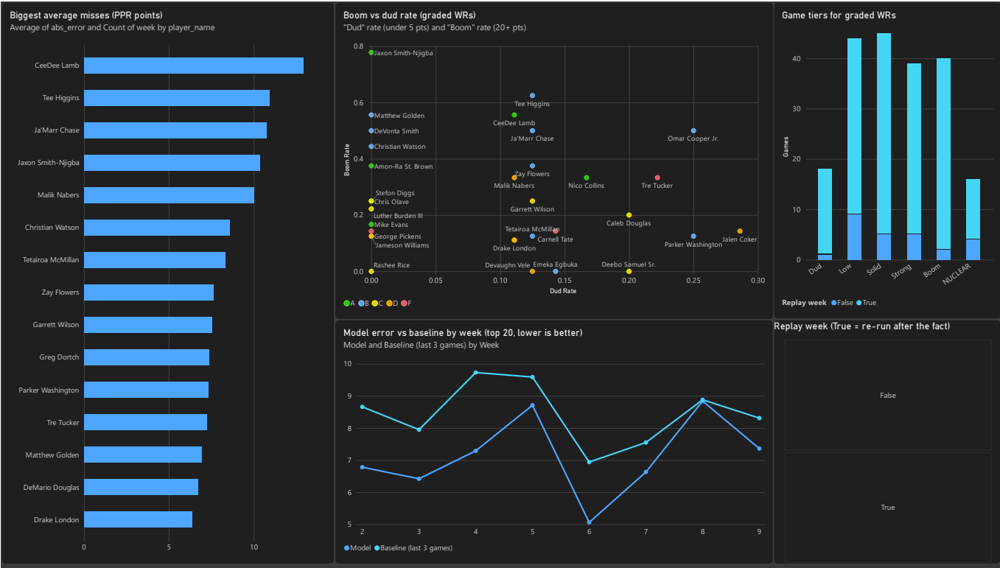

# NFL Wide Receiver Fantasy Projections

**Live site: https://wr-projections.vercel.app**

A machine learning pipeline and website that project each NFL wide receiver's fantasy production for their next game, using only information available before kickoff. Predictions are saved publicly before each game and scored against what actually happened.

Fantasy football is noisy, so the goal isn't a perfect forecast. It's a reproducible model with an honest answer to one question: does it beat a simple alternative?

## Results so far

**Headline: 16% lower MAE than the baseline (7.10 vs 8.47)**, replaying 2026 weeks 2-8 for each week's top 20 receivers, the same players the site scores. Each week was predicted using only earlier games:

| Measure | Model | Last-3-games average |
|---|---|---|
| Average points miss (MAE, lower is better) | 7.10 | 8.47 |
| Ranking of players (Spearman rank correlation, averaged by week, higher is better) | 0.29 | 0.18 |

Other MAE figures in the project log cover different players or seasons and say so. For example, MAE across every WR game is lower, around 4.7, because it includes low-usage receivers who are easy to predict.

These numbers are a test of the method, not proof. The real test is predictions saved before kickoff, starting with week 9 of 2026, in [`backend/predictions/`](backend/predictions/).

**First live week (week 9 of 2026):** for the 20 receivers predicted before kickoff (18 played), the model missed by 7.36 points on average, against 8.31 for the last-3-games average, and ranked players at 0.45 against 0.11. One week is too few to judge. The verdict needs four finished live weeks, and the site's Accuracy tab updates as each one is scored. A week's predictions freeze at kickoff, and the git history shows when each was made. [`check_freeze.py`](backend/check_freeze.py) enforces this: CI and the daily job fail if any commit added, edited or removed a prediction for a game that had already started.

## Power BI dashboard

[](docs/powerbi/wr_accuracy.pbix)

Built in Power BI Desktop from CSVs written by [`export_powerbi.py`](backend/export_powerbi.py). Click the image to download the [`.pbix`](docs/powerbi/wr_accuracy.pbix) (opens in Power BI Desktop).

- **Model error vs baseline by week:** the model's average miss was lower than the last-3-games baseline in every week from 2 to 9, with week 8 close to a tie. Weeks 2-8 are replays; week 9 is the first live week.
- **Biggest average misses:** the largest average misses belong to high-scoring receivers such as CeeDee Lamb and Ja'Marr Chase, whose points swing more from week to week, rather than to low-usage ones.
- **Game tiers for graded WRs:** this season's tier spread (Dud 9%, Low 22%, Solid 22%, Strong 19%, Boom 20%, NUCLEAR 8%) matches the 2023-2025 data the tiers were set from, so the cutoffs hold up on new games.
- **Boom vs dud rate:** the grade measures a floor (games at 10+), the scatter shows the ceiling. A receiver can avoid duds and still grade F by living at 5-10 points.

## How it works

```
nflverse data ──> features ──> one Ridge model per stat ──> projections.json ──> website
                                        │
                                        └──> prediction log ──> scored against actual results
```

A scheduled GitHub Action runs this daily during the season: it pulls fresh data, retrains, updates the projections and scores, and commits the results. That commit is what publishes new numbers to the site, so there's no backend server to host or keep awake.

- **Supervised learning:** Ridge regression, trained on past player-games labeled with what happened in the player's next game.
- **Projected stats:** targets, catches, receiving yards, receiving touchdowns, carries, rushing yards and official PPR points.
- **Inputs:** recent production and usage, target share, air yards, plus the next game's home or away status, dome, game total and implied team total.
- **Players:** the model trains on all receivers. The site highlights the top 20 by points so far, and search reaches the other active receivers.

## How it's evaluated

- **No future information:** every input must be known before kickoff. Past weeks are replayed by removing later games before any features are built, so a replay can't see the games it's predicting.
- **A simple baseline to beat:** each player's average over their last 3 games.
- **A passing bar:** over the latest 4 finished live weeks, all 20 predictions made, and better than the baseline on both MAE and ranking.
- **Weekly review:** predicted vs actual tables for targets, catches and points.

## What testing changed

Most ideas didn't survive testing, and the [project log on the site](frontend/src/lib/projectLog.ts) records them along with the ones that did. A few examples:

- **Removed weather:** game-time weather isn't known before kickoff. Accuracy didn't change, and usable training rows rose from 6,117 to 10,640.
- **Replaced my own target:** a fixed ranking score of 0.30 turned out to be largely luck over 4 weeks, because the score swung from 0.05 to 0.37. The bar now compares against the baseline.
- **Kept the simple model:** boosted trees, random forest, past prediction errors, 10 groups of extra opportunity data and touchdown-specific models didn't reliably beat Ridge regression.
- **Found the limit:** touchdowns drive the biggest misses and remain hard to predict, while target and catch totals stay close on average.

Full findings are in [ROADMAP.md](ROADMAP.md).

## Tech stack

| Area | Tools |
|---|---|
| Data | Python, Polars, [nflreadpy](https://github.com/nflverse/nflreadpy) |
| Modeling | scikit-learn |
| Website | React, TypeScript, TanStack Start, Tailwind CSS |
| Automation and hosting | GitHub Actions, Vercel |

The frontend was scaffolded with Lovable, and the project was developed with help from Claude Code. Learning to work well with AI tools is one of the project's goals.

## Repository layout

```
backend/
  wr_predictor/   pipeline: data loading, features, targets, models, prediction scoring
  train.py        trains the models and writes projections and the prediction log
  evaluate.py     scores predictions and writes accuracy results
  export_powerbi.py  flattens the site's data into CSVs for Power BI
  predictions/    prediction logs, review tables and reports
  tests/          unit tests
frontend/         React site, reading its data from public/data/
docs/powerbi/     Power BI dashboard (.pbix) and its screenshot
notebooks/        data exploration
```

## Run it locally

```bash
# Backend, from backend/
pip install -r requirements-dev.txt
python -m pytest
python train.py
python evaluate.py          # add --replay to regenerate this season's past weeks

# Frontend, from frontend/
bun install
bun run dev
```

## Roadmap

The checklist and open decisions are in [ROADMAP.md](ROADMAP.md). Future ideas include roster-based pivots when a top player is hurt, rest-of-season rankings, a player news overlay and more positions.

## Disclaimer

This is an analytics and learning project. Projections are estimates, not guarantees or betting advice.
